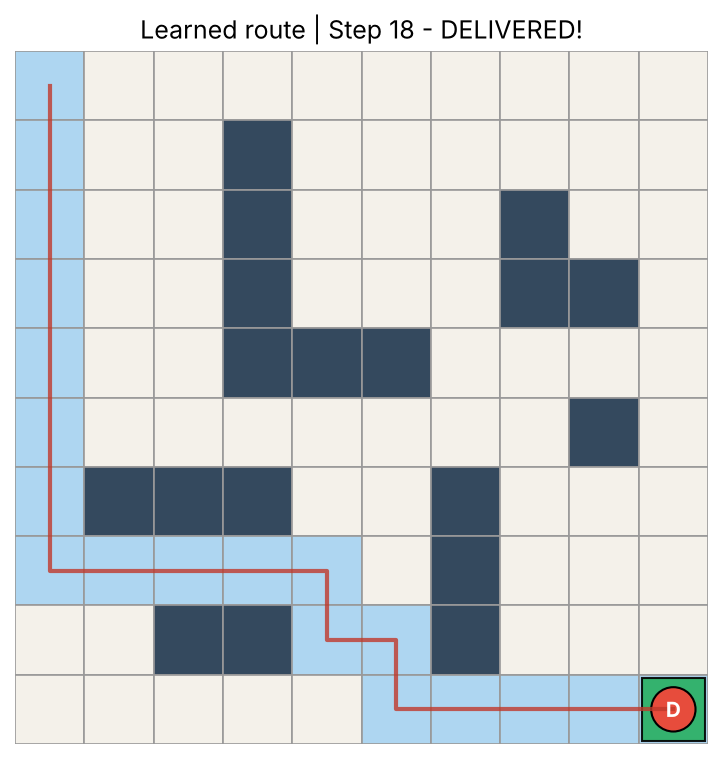
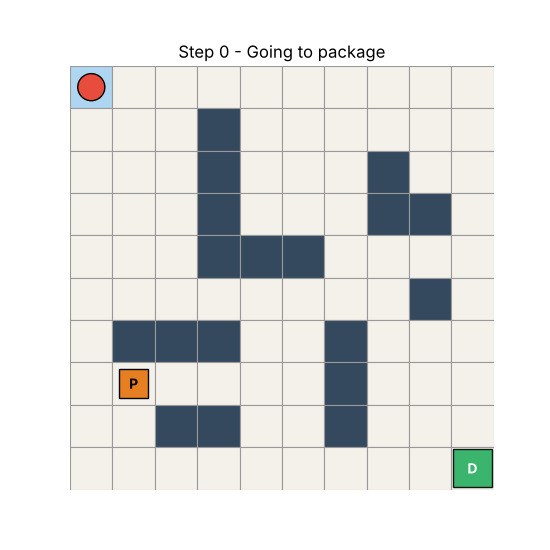
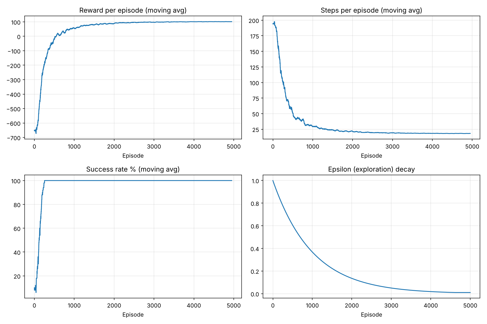
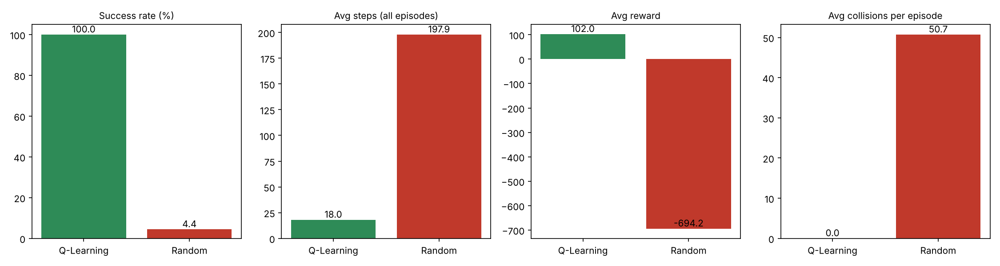

# 🤖 Warehouse Robot Path Planning with Q-Learning

An intelligent warehouse robot that **learns** — by trial and error, using tabular Q-Learning written from scratch in NumPy — to pick up a package, avoid obstacles and deliver it to a delivery station in a 10 × 10 grid warehouse.




## Features
- Configurable grid warehouse (size, obstacles, start / package / station positions)
- Q-Learning implemented from scratch (no RL libraries)
- State includes `has_package`, so the robot knows whether it is carrying the package
- Epsilon-greedy exploration with decay
- Matplotlib visualisation + animated GIF (works in Google Colab)
- Evaluation against a random-movement baseline using real simulation results

## Tech stack
Python · NumPy · Matplotlib · Pillow · Google Colab · GitHub

## Project structure
```
warehouse_robot/
├── environment.py      # grid world, rewards, step()
├── q_learning.py       # Q-table, epsilon-greedy, Bellman update
├── training.py         # training loop
├── visualization.py    # drawing, route, animation
├── evaluation.py       # Q-Learning vs random, graphs
├── main.py             # runs everything
├── warehouse_robot_colab.ipynb
├── requirements.txt
├── models/q_table.npy
├── results/graphs/ , results/metrics.json
└── docs/REPORT.md, docs/VIVA_QUESTIONS.md
```

## How it works
| Concept | In this project |
|---|---|
| **State** | `(row, col, has_package)` → 10×10×2 = 200 states |
| **Actions** | UP, DOWN, LEFT, RIGHT (pickup and delivery happen automatically when the robot enters the package / station cell) |
| **Update rule** | `Q(s,a) ← Q(s,a) + α [ r + γ·max Q(s',a') − Q(s,a) ]` |
| **Hyper-parameters** | α = 0.1, γ = 0.95, ε: 1.0 → 0.01 (×0.999 per episode), 5000 episodes |

### Rewards
| Event | Reward | Why |
|---|---|---|
| Each move | −1 | Penalises wasted movement → shortest route |
| Hit obstacle | −10 | Teaches the robot to avoid blocked cells (it stays in place) |
| Leave the grid | −10 | Penalty for invalid movement |
| Pick up package | +20 | Encourages collecting the package first |
| Deliver package | +100 | Main goal; ends the episode |
| Reach station without package | −5 | Discourages useless visits |

## Run it
**Locally**
```bash
pip install -r requirements.txt
python main.py
```
**Google Colab**
1. Upload `warehouse_robot_colab.ipynb` to https://colab.research.google.com (File → Upload notebook), or open it from your GitHub repo.
2. Runtime → Run all.

## Results (500 evaluation episodes each, from `python main.py`, seed fixed)
| Metric | Q-Learning | Random |
|---|---|---|
| Successful deliveries | 500 / 500 | 22 / 500 |
| Success rate | 100 % | 4.4 % |
| Avg steps | 18.0 | 197.9 |
| Avg reward | 102.0 | −694.2 |
| Avg collisions / episode | 0.0 | 50.7 |

The learned route is 18 steps, which equals the shortest possible path for this layout (Manhattan distance start→package→station is 8 + 10 = 18, and the obstacles do not force a detour).




## Limitations / future work
Tabular Q-Learning only works for small state spaces; extend with multiple packages, moving obstacles, or Deep Q-Networks (DQN).

## Documentation
- [Project report](docs/REPORT.md)
- [Viva questions](docs/VIVA_QUESTIONS.md)

## License
MIT
